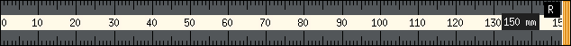

# rulertoo

Borderless on-screen ruler for X11 that uses **real physical dimensions**
from XRandR (not global DPI).



## Features

- Classic marks: mm / 5 mm / cm
- Scales to the monitor it sits on (XRandR mm sizes)
- Horizontal or vertical
- Resize by dragging the free-end handle (right or bottom)
- Shift numbering origin with middle-button drag
- Units: cm, mm, inch, pixel (cycle with `u`)
- Semi-transparent background; marks drawn fully opaque
- CLI options for length, height, alpha, unit, orientation
- Remembers position, orientation, unit, length, thickness, alpha and per-monitor calibration
- Shift-C calibration against a real 30 cm reference when EDID sizes are wrong

## Controls

| Input | Action |
|-------|--------|
| Left-drag body | Move |
| Drag free end | Resize length |
| Middle-drag | Shift zero / numbering origin |
| Click **R** button or `r` | Rotate |
| `u` | Cycle unit |
| `Shift-C` | Calibrate (match real 30 cm, Enter saves) |
| Right-click / Esc / `q` | Quit |

## Version

The top-level `VERSION` file is the single source of truth for CMake and Nix.

## Build

```bash
nix build && ./result/bin/rulertoo
nix run
# develop loop:
nix develop -c rulertoo-run
# or
cmake -B build -G Ninja && cmake --build build && ./build/rulertoo
```

Installed packages also ship a `.desktop` entry, scalable icon, and
AppStream metainfo so the ruler appears in application menus and software
centres.

## Licence

GPL-3.0-or-later
